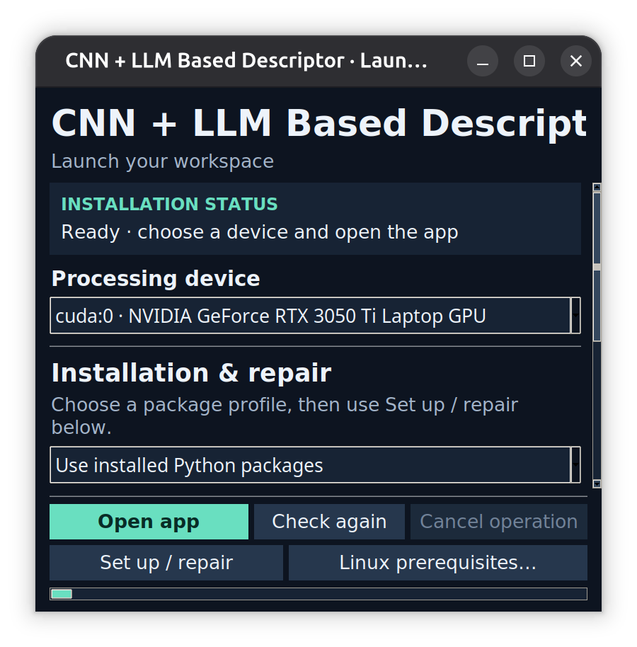

# CNN + LLM Based Descriptor

A desktop experiment for comparing **LLM-based decision making with conventional AI** in latency, accuracy against reference labels, and computational work. It combines a YOLO CNN detector with either quantized Qwen3-VL 2B or named **search and probability algorithms**, or **General Algorithmic Approach** with predefined robot action plans backed by a YOLO-label knowledge base. Detection facts and action targets come from **YOLO detections**, with exact counts, bounding-box positions and confidence scores. Each method exposes its decision explanation: LLM natural language, search traversal, probability calculations, or matched robot-plan rules.

A camera-first Python GUI for YOLO26 n / s / m / l / x, with NVIDIA GPU and CPU support, including Raspberry Pi and other 64-bit single-board computers.

## Post-YOLO action evaluation

Read the [action-selection report](Reports/Post_YOLO_Evaluation/Post_YOLO_Evaluation.pdf) for how all nine methods process YOLO evidence, their recorded responses, numerical performance, and a practical ranking by action-selection efficiency. The October 29, 2026 benchmark uses 24 COCO validation images, separate policy/plan-quality tests, and measured post-YOLO latency. COCO provides human object annotations; action scores are **policy agreement**, not human-labeled robot action accuracy.

[Per-method metrics](Reports/Post_YOLO_Evaluation/performance_metrics.csv) include accuracy, precision, recall, F1, balanced accuracy, response availability and latency. [Reference labels for every image](Reports/Post_YOLO_Evaluation/ground_truth.csv), original annotation details, and [supporting measurements and response examples](Reports/Post_YOLO_Evaluation/) accompany the report.

## Screenshots

The preview and descriptor stay together. This real local Qwen example shows **Environment (LLM)**, **Decision (LLM)** and its natural-language **Description (LLM)**. The shown latency is one sample, not a performance benchmark.


<details>
<summary>Robot action plans, search traversal, probability calculations, and method comparison</summary>

The robot-plan screenshots use the bundled bus image and actual YOLO detections. The selected plan, rule matches, recommended steps and measured latency are shown; the timing is a single sample, not a benchmark.


The search screenshot uses an explicitly labeled **synthetic detector fixture** to show a nonempty review graph. It has no Environment section.


The probability and comparison screenshots use the bundled bus image and its actual YOLO detections. The comparison has no reference labels supplied, so accuracy is not scored.


</details>

The launcher provides device selection, installation status, and setup controls.



## Open

Run **Run_CNN_LLM_Based_Descriptor.sh** with no arguments. On this PC it is in `~/Projects/CNN_LLM_Based_Descriptor`.

The launcher checks your installation. Select a device and click **Open app**. Launch, check, cancel, repair and Linux prerequisite buttons remain visible in a fixed bottom bar. Installation options and the activity log scroll independently. No setup flags are required.

The app opens at 1440×900 on larger displays, with the camera preview and scene description side by side. Preview and Description remain visible together at every supported size: side by side on wide or short windows, and stacked on narrow, taller windows. The description scrolls independently. Open, Stop, Record and Snapshot stay in a fixed bottom bar. **Decision:** is prominent, with red **Take Action** and green **No Action** highlights. Settings pages scroll, including every model-download button. The app supports windows down to 760×520; the launcher supports 640×480 and does not shrink itself after checking dependencies.

## Code organization

Post-YOLO methods live in `cnn_llm_based_descriptor/algorithms/`, grouped by approach:

```text
cnn_llm_based_descriptor/
├── algorithms/
│   ├── factory.py                 # Select a client from RunConfig
│   ├── llm/
│   │   ├── client.py              # Vision decision, explanation and retry
│   │   ├── prompts.py             # Detection-grounded vision prompt
│   │   ├── transport.py           # Local requests and model download
│   │   └── model_store.py         # Project-local Ollama service/weights
│   ├── search/
│   │   ├── client.py              # Search descriptor and result rendering
│   │   ├── targets.py             # Detected objects -> review targets
│   │   ├── planner.py             # Strategy dispatch and five-target batches
│   │   ├── breadth_first.py       # BFS
│   │   ├── depth_first.py          # DFS
│   │   ├── iterative_deepening.py  # IDS
│   │   ├── uniform_cost.py        # UCS: accumulated cost
│   │   ├── greedy_best_first.py   # GBFS: heuristic only
│   │   ├── astar.py               # A*: accumulated cost + heuristic
│   │   ├── priority.py            # Shared heap frontier handling
│   │   ├── state.py               # States, costs, heuristic and audit
│   │   └── explanation.py         # Search trace and selected plan
│   ├── probability/
│   │   ├── client.py              # Probability descriptor
│   │   ├── inference.py           # Scene enumeration and review probability
│   │   └── explanation.py         # Probability calculations
│   ├── robot_plans/
│   │   ├── client.py              # General Algorithmic Approach descriptor
│   │   └── plans.py               # Twelve rules, priority and count logic
│   └── shared/
│       ├── evidence.py            # YOLO filtering and box normalization
│       ├── grounding.py           # Allowed choices, validation and rendering
│       ├── review_policy.py       # Label/score rules for search/probability
│       ├── knowledge.py           # Knowledge-base loading and validation
│       ├── scene_model.json       # Shared label/action and scene tables
│       ├── scenes.py              # Allowed environments/settings
│       └── action_names.py        # Shared suggestion display names
├── descriptor.py                  # Async frame scheduling and saving only
├── methods.py                     # GUI/settings method names
├── measurement.py                 # Common descriptor timing boundary
└── paths.py                       # Stable project root for stored models
```

The GUI, camera, YOLO engine, recording and comparison modules remain at package level. All approaches expose `client.describe(frame, records)` through `algorithms.factory.create_descriptor_client(cfg)`. Frame scheduling is independent of the algorithm, and shared evidence/output rules keep comparisons consistent. To change one search strategy, open its named file; UCS, greedy best-first and A* reuse `priority.py` while defining their own ranking rule.

Search and probability now have separate `SearchClient` and `ProbabilityClient` classes instead of a combined `ClassicalClient`. Internal imports should use the folders above. Stored settings, method names, result fields, model locations and existing action policies are unchanged. The historical evaluation report refers to its recorded source commit; the reorganization does not remeasure its latency figures.

## Choose a descriptor and algorithm

Open **Settings → Descriptions → Descriptor type** before opening the input. The **Algorithm / LLM model** field shows the actual method. The descriptor panel identifies the selected category and method for every result:

| Descriptor type | Available method |
| --- | --- |
| LLM | The selected local vision model, initially `qwen3-vl:2b` |
| Search Algorithm | Breadth-First Search (BFS) |
| Search Algorithm | Depth-First Search (DFS) |
| Search Algorithm | Iterative Deepening Search (IDS) |
| Search Algorithm | Uniform-Cost Search (UCS) |
| Search Algorithm | Greedy Best-First Search (GBFS) |
| Search Algorithm | A* Search |
| Probability Algorithm | Inference by Enumeration |
| General Algorithmic Approach | Priority-Based Robot Action Plans (12 automatic plans) |

These search methods match the state-space search material in the CIS 579 search project; probability mode uses the conditional-probability and enumeration material. Old settings with the label “CIS 579” migrate to **Search Algorithm → Uniform-Cost Search (UCS)**. Existing LLM settings retain the selected model.

**Description inference latency** is shown beneath the method, in milliseconds for fast results and seconds for longer ones. It is measured for each complete descriptor call, including probability/search work and explanation formatting or LLM prompt preparation, local-server work, and validation. It excludes YOLO inference, time waiting in the frame queue, saving the result, and GUI drawing. Full precision is saved as `inference_latency_ms` and `elapsed_seconds`; this is separate from the YOLO timing below the preview. **No Action** is green; **Take Action** is red.

<details>
<summary>Updated descriptor and algorithm-selector screenshots</summary>


</details>

### Knowledge base and all-label coverage

Search and probability modes use YOLO's returned labels, confidence scores, and boxes, without reading image pixels or calling Ollama. The knowledge base in [`scene_model.json`](cnn_llm_based_descriptor/algorithms/shared/scene_model.json) explicitly covers **all 80 standard YOLO/COCO labels**, with a scene-association likelihood and a decision association for each. It includes rooms and public places, farms, wildlife areas, waterfronts, snowy recreation areas, and airports. A place estimate never adds an object to the detection list.

**Every eligible returned detection is assessed.** The LLM's object/prompt limit does not apply to search or probability modes. The old ten-object and eight-review-target cutoffs are removed. This still respects the selected YOLO confidence threshold, class filter, NMS, and maximum-detection setting; a label in the model vocabulary is not treated as a detected object. Missing labels remain unobserved. All returned boxes remain in the facts and decision assessment, including duplicate classes and tentative detections.

Probability scene associations use each observed class once at its strongest returned score, preventing repeated people/chairs from multiplying the same evidence. Low-score detections contribute weaker scene evidence and get verification advice. Custom labels also receive a decision assessment: tentative labels can be verified, while confident object presence alone implies no action. With no defined scene association, their likelihood is equal across settings and does not invent a location. Generic labels can therefore have a neutral influence without being discarded.

### Search algorithms

Search mode has **no environment prediction or Environment section**. The chosen search algorithm plans conditional review suggestions for **all** rule-triggered targets. Signals can prompt checking their actual state; knives/scissors can prompt care if handled; low-score boxes can prompt verification. Every other detection is explicitly assessed as object presence without a required action.

| Algorithm | Frontier behavior | Review-plan tradeoff |
| --- | --- | --- |
| BFS | FIFO queue, shallowest state first | Fewest steps in a batch; does not minimize weighted cost |
| DFS | LIFO stack, deepest branch first | Quick first plan; no minimum-cost guarantee |
| IDS | Repeated depth-limited DFS | Fewest steps with repeated exploration |
| UCS | Lowest accumulated cost first | Minimum-cost plan within each batch |
| Greedy Best-First | Lowest estimated remaining cost first | Fast heuristic plan; no minimum-cost guarantee |
| A* | Lowest accumulated cost plus heuristic first | Minimum-cost plan within each batch |

State consists of the targets already included in the plan and the last target. Each edge adds one allowed, detection-linked review suggestion. Cost is illustrative review effort plus the normalized Manhattan attention shift between image-box centers. The heuristic sums the remaining minimum review efforts and the cheapest initial shift; it is a lower bound because further shifts are omitted.

Targets are processed in consecutive batches of five to bound exponential work. **Every batch is processed, with no omitted targets.** UCS/A* optimality is within each batch; the combined plan is not claimed to be globally optimal. This plans how to review an image; it is not physical navigation and does not execute actions. The first planned suggestion becomes the displayed decision. The descriptor shows **Description (Search Algorithm)**: actual visited states with detection labels/IDs, path prefixes, depth limits for IDS, accumulated cost `g`, heuristic `h`, priorities where used, goal markers, and the selected review path. It also reports generated/expanded states and peak frontier size. All targets are processed; at most 250 expansion records are displayed/stored, with any omitted count explicit. **Details** and saved metadata retain these values and all selected steps. If no rule fires, the description explains why no search frontier is expanded.

### Probability algorithm

**Inference by Enumeration** computes the scene posterior by enumerating all scene hypotheses and normalizing:

`P(S | E) = normalize(P(S) × product(P(observed label and score band | S)))`

The model assumes distinct observed classes are conditionally independent given the scene. For a low-score observation, its likelihood blends 30% of the class table with 70% of the prior-predictive mean, making it less informative. This blend is an illustrative model parameter, not the YOLO score treated as a probability of correctness. A specific setting requires at least two strong informative cues, top posterior ≥55%, and a ≥15-point lead; otherwise it stays unclear.

Probability mode evaluates each detection with the explicit conditional table `P(review useful | detected label, score band)` and selects the strongest recommendation at or above 50%. The initial illustrative values are 80% for verifying a tentative label, 85% for checking a detected signal, 75% for care if a detected knife/scissors is handled, and 15% for presence-only cases. These express a review policy, **not danger or object-correctness probabilities**. Probability mode performs no search. The descriptor shows **Description (Probability Algorithm)** with every detection's YOLO score and conditional review probability, the maximum-probability/threshold calculation, all scene priors and posteriors, numeric log-joint normalization, and the leading scenario's likelihood products. Low-score mixing is shown as an explicit weighted calculation. Full factors and intermediate values are saved separately for verification.

All priors, likelihoods, cue rules, review probabilities, and effort costs are hand-authored teaching assumptions. They have not been calibrated on a labeled dataset. The GUI labels probability estimates accordingly. **No Action** does not certify that a scene is safe. Classification-only input and empty detections produce YOLO facts without object-based scene or action inference.

Algorithm references: [probability and inference by enumeration](https://inst.eecs.berkeley.edu/~cs188/textbook/bayes-nets/inference.html), [uninformed search](https://inst.eecs.berkeley.edu/~cs188/textbook/search/uninformed.html), [greedy and A* search](https://inst.eecs.berkeley.edu/~cs188/textbook/search/informed.html).

### General Algorithmic Approach

Choose **Settings → Descriptions → Descriptor type → General Algorithmic Approach**. The **Priority-Based Robot Action Plans** method evaluates 12 predefined rules on every sampled frame and automatically selects the applicable plan. No LLM or probability calculation is used. All eligible YOLO boxes and labels, including custom classes, contribute to object counts; the LLM object limit does not apply.

The descriptor displays **Action Plan**, **Decision**, **Reason**, **Robot steps**, and **Description (General Algorithmic Approach)**. It shows each rule's actual count, threshold, pass/fail result, priority, and detection assignments. There is no environment prediction. Latency and computational work (rules, conditions, detections assessed) are recorded for comparison.

Rules below are evaluated in priority order. Counts for named groups and strong objects use boxes with **at least 50% YOLO confidence**; tentative boxes meet the user's detection threshold but are below 50%. All eligible boxes contribute to the total. Confidence is a detector score, not a probability that an action is correct.

| Automatic robot action plan | Rule | Decision / recommendation |
| --- | --- | --- |
| Crowded-Area | At least 5 people | Take Action: pause intended movement nearby and review positions |
| People-and-Vehicles | At least 1 person and 1 vehicle | Take Action: hold intended movement and review both groups |
| Signal-Review | At least 1 traffic light or stop sign | Take Action: check the actual signal state before related movement |
| Animal-Presence | At least 1 animal | Take Action: review positions before moving nearby |
| Tool-Handling | At least 1 knife or scissors | Take Action: inspect before any planned handling |
| Uncertain-Detection | At least 1 tentative box | Take Action: acquire another view to verify the label |
| Dense-Object | At least 10 strong boxes of any labels | Take Action: pause intended movement and review object positions |
| Vehicle-Presence | At least 1 vehicle | Take Action: review positions before moving nearby |
| People-Presence | 1–4 people | Take Action: allow space if moving nearby |
| Empty-Area | Zero eligible boxes | No Action: retain idle/monitoring state |
| Sparse-Object | 1–3 strong boxes and no tentative boxes | No Action, unless an action rule above matches |
| Moderate-Object | 4–9 strong boxes and no tentative boxes | No Action, unless an action rule above matches |

**Any action match overrides idle rules.** The first matching action plan is the primary plan; steps from every matching action plan are retained and attributed. A few detected objects can therefore trigger a specific plan, while several ordinary objects can yield No Action. Vehicle and animal groups enumerate the corresponding standard YOLO labels in [`plans.py`](cnn_llm_based_descriptor/algorithms/robot_plans/plans.py). Other standard and custom labels still participate in strong/tentative/total count rules. Saved metadata includes the selected and matching plans, all rule evaluations, conditions, counts, detection IDs and scores, and policy version.

The 5-person and 10-object cutoffs are explicit, hand-authored demonstration thresholds. Counts are filtered detections in one frame, not unique tracked objects or measured physical density. **Empty-Area** means zero eligible detections, not proof of an empty or traversable space. Classification mode cannot count objects and does not run these rules. These are recommended robot steps; the app sends no robot commands and does not establish distance, motion, or a clear route. No Action means no change requested by this policy, not permission to move.

## Compare methods on the same frame

Open an image, or stop a camera/video on a frame with YOLO enabled, then click **Compare** above the preview. This freezes the clean image and its full detection result. The comparison runs all six searches, Inference by Enumeration, Priority-Based Robot Action Plans, and the selected LLM serially without rerunning YOLO. Use one to five repetitions; method order rotates across repetitions. Select any result to read its explanation/traversal/calculations and export **CSV** or full **JSON**. Exports include a stable frame/evidence identifier so independent samples can be grouped without counting repeated runs as new frames.

- **Latency:** complete descriptor-call time, including preparation, inference, validation and explanation formatting. Model loading is included when it occurs; lightweight client/knowledge-base construction happens outside the descriptor-call timing boundary. YOLO, queue wait, GUI updates and saving are excluded. Repetitions show individual measurements; no warmup is silently discarded.
- **Accuracy:** optionally supply independently determined **Expected decision** and **Expected setting**. The table shows match/mismatch for this frame. Search and robot plans have no environment output, so its setting match is not applicable. Invalid answers count as mismatches when a reference exists. Without a reference, accuracy is not scored. Repeated runs on one frame are not additional accuracy samples; evaluate many independently labeled frames and aggregate the exports before claiming dataset accuracy. YOLO confidence and probability-model posteriors are not accuracy.
- **Efficiency:** search reports expanded/generated states and peak frontier nodes; probability reports hypothesis/likelihood and review counts; robot plans report rules, conditions and detection counts; LLM reports input/output tokens and server timing when available. These work units differ, so they do not establish a common energy, memory, or operation-count ranking. Energy and peak RAM/VRAM are not measured.

**Comparison conditions are visible.** The LLM receives image context as well as detections; conventional methods only use labels, confidence and boxes. All eligible predictions reach the conventional algorithms, while the LLM object/context limit can omit some. Coverage is shown per row. The frozen image is limited to preview resolution (1280×900), and box coordinates are scaled consistently. System load, model residency, image context and evidence coverage affect results. This compares the configured pipelines, not strictly identical information or independently measured general accuracy.

The decision policies also differ: search/probability methods use the explicit teaching table, robot plans use the count-and-label policy above; the LLM selects from the offered grounded suggestions. Searches order review suggestions rather than learning a scene classifier. Interpret decision disagreement in that context and define the annotation policy before labeling an evaluation dataset.

## Local vision descriptions

1. Install [Ollama](https://ollama.com/download) (0.12.7 or newer). The app starts its own local model service when needed.
2. Open **Settings → Descriptions → Download model** (or run `python3 setup_descriptor.py` from this project). It downloads and verifies **qwen3-vl:2b**, a small **Q4_K_M (4-bit)** vision-language model, about **1.9 GB** on disk. Runtime RAM/VRAM usage is higher than download size. YOLO also needs memory; use Nano or CPU inference on a 4 GB GPU. The Qwen pipeline was tested with YOLO Nano on a 4 GB RTX 3050 Ti; the earlier choices-only version took about 6–7 seconds in a warmed sample-image test; the current decision-plus-explanation pipeline makes a decision call and explanation call (plus at most one correction) and reports its actual timing in the GUI, so it is not a per-frame real-time captioner. LLM weights are stored in the project’s `Models/ollama/` folder; YOLO weights are stored directly in `Models/`. Weights are excluded from Git.
3. Open **Run_CNN_LLM_Based_Descriptor.sh**, select your source, and leave YOLO inference enabled. Descriptions are enabled by default. Use **Settings → Descriptions** to disable them or change the local model, server, sample interval, or timeout.
4. Read the **Descriptor** panel beside or below the preview. It shows **Detections** plus the sections appropriate to the selected method. LLM sections are explicitly labeled **(LLM)**, search descriptions show traversal without Environment, and probability descriptions show calculations. Its frame number (and source timestamp for video files) identifies the described frame; descriptions can lag behind live video. **Details** includes the full description, validation status, action decision, reason and exact detection evidence.

The LLM uses its predicted environment together with the supplied YOLO labels, confidence scores and boxes to choose a decision. Its sections are **Environment (LLM)**, **Decision (LLM)**, and **Description (LLM)**. The description is a concise model-written explanation of that decision, not an application-generated reason template or a transcript of internal reasoning.

The vision call returns three JSON choices: `environment`, `setting`, and `next_step`. A second text-only call writes `reason` from those validated choices, the suggestion meaning, and detection IDs, labels and confidence bands. References resolve to YOLO labels and scores; explicitly named labels must be cited; the explanation call sees no image. The explanation can make one correction attempt if it fails validation. All local calls, including that correction when needed, are included in latency and token totals; `model_calls` records the count. The first three remain bounded choices; actions must target supplied detections. The explanation is model-generated natural language, with checks that can reject unsupported wording. The reason must cite current evidence as `[d1]`, `[d2]`, etc., including the selected target. The app replaces references with the detector's label and exact confidence, and rejects malformed answers, unknown references, uncited object names, a list of unsupported background/state/distance claims, new numeric claims, and markup. Object lists, counts, positions, and action wording remain generated from YOLO evidence.

Natural-language checks are **not a proof that every sentence is true**. The displayed explanation is explicitly attributed to the LLM; it can still be mistaken and should be evaluated against independent reference labels. The place estimate is also unconfirmed. Failed answer validation shows YOLO facts and explains why no recommendation is available; raw rejected text is not saved.

**No Action** means no specific action is recommended from the supplied evidence; it does not declare the scene safe. An empty detection list, classification-only input or an invalid model answer also shows **No Action**, with **Reason** explaining why a recommendation is unavailable. A valid model answer can select **No Action** even when objects are detected.

Suggestions are general scene guidance: inspect a detected object, allow space if moving nearby, confirm a low-score detection, inspect before handling a detected knife/scissors, or check the actual state of a detected signal. These suggestions do not assert motion, signal color, distance, danger, or that a route is clear. For example, a person detected at the left may prompt “If moving nearby, leave space around the detected person.” A visible object absent from YOLO's supplied detections cannot appear in the object summary or suggestion. The place type and indoor/outdoor context are separately marked as **model estimates** and can be wrong. The setting label cannot introduce extra object descriptions.

The Qwen3-VL vision decision uses the compatibility prefill. Its text-only explanation uses Ollama's raw generation endpoint with a Qwen prompt and a simple JSON schema, avoiding the installed chat renderer's forced-thinking behavior. Alternative model families use their normal chat template. Rejected explanations can be corrected once, and every call is measured.

The default samples at most once every three seconds, with a 220-token output limit and a 180-second request timeout to allow the first model load. One background request and one latest pending frame keep memory bounded and video preview responsive. Cancel download stops after the current network read; downloading again resumes cached progress. Ollama chooses its GPU/CPU placement independently of YOLO. The model receives the original frame resized to at most 640 px, plus up to 10 predictions ordered by confidence: IDs, labels, scores, normalized boxes, and spatial positions. Exact pixel boxes remain in the saved evidence. Only valid boxes at or above the selected detection threshold qualify. Axis-aligned extents represent oriented boxes. Extra predictions and objects dropped to fit the context window are counted as omitted and cannot be suggestion targets. Counts cover listed predictions only. With no detections, the app skips the model and says no objects were detected; it does not call the scene empty. Classification results are shown as class candidates, with no object counts, positions or object-specific advice, and no vision-model call.

Confidence percentages are **YOLO detector scores**, not measured accuracy or confidence in the environment estimate. Detections below 50% are marked tentative and can only receive a verification suggestion. YOLO can still miss or misclassify objects; the descriptor preserves its predictions rather than substituting the vision model's guesses. Suggestions are conditional guidance for reviewing the scene, not movement commands. No cloud endpoint is used: the server must be loopback, proxy forwarding and redirects are disabled, and cloud-only models are rejected. Alternative local models must report vision support and quantized weights and support structured JSON output.

Descriptions are generated only when YOLO inference is on. A missing model, failed server startup, invalid model or timeout disables descriptions for that run and displays recovery instructions; detection and recording continue. Reopen the input after fixing the problem. Still images and normal video EOF wait for pending descriptions. **Stop** cancels pending work without waiting for a model response; an already submitted request can finish inside Ollama, but its caption is discarded. The dedicated project service uses `127.0.0.1:11435` and `OLLAMA_MODELS=Models/ollama`. It starts on demand and remains available in the background, unloading idle model memory after five minutes. A custom loopback server can still be selected in Settings. The shared Ollama service on port 11434 is unaffected.

When recording or saving an image, sampled descriptions are written to `descriptions.jsonl` beside `predictions.jsonl`, with their original frame number, source time, model name, generation time, frame dimensions, exact evidence, `action_decision` and `reason`. A caption can finish after its recording is stopped, and still belongs to that recording's directory. Manual Stop can discard unfinished captions. Captions are displayed in the panel and saved as metadata; they are not burned into video frames.

Source: [Ollama generation API](https://docs.ollama.com/api/generate), [Qwen3-VL 2B model and quantization](https://ollama.com/library/qwen3-vl:2b), [Ollama vision API](https://docs.ollama.com/capabilities/vision), [Ollama structured outputs](https://docs.ollama.com/capabilities/structured-outputs).

## Live camera and recording

1. Choose **Webcam**, select your camera by name, and click **Open camera**. On Linux, **Refresh** updates the list after plugging in a camera. Other operating systems use a camera index, usually **0**. Live preview and inference do not need a video file or save location. An empty or missing saved file input resets to Webcam when the app opens.
2. Use **Enable inference** to turn YOLO on or off while the camera stays open. Turn it off before opening the camera for camera-only operation without loading a model.
3. Select a recording mode, then click **Record** and choose an MP4 filename. Cancel the dialog to keep previewing without recording:

   | Mode | Saved video |
   | --- | --- |
   | Original | Clean camera frames without overlays, whether inference is on or off |
   | With inference | Annotated video with model results |
   | Both | Annotated video at the chosen filename, plus a separate `_original.mp4` video |

4. Click **Stop recording** to finish the clip. The camera continues previewing, and you can start another clip.
5. Click **Stop** (or press Esc) to finish any recording and close the camera.

Overlay recording requires inference. Turning inference off during an annotated/Both recording finishes that clip; original-only recording can continue across inference changes. Model loading and inference finish their current operation before changes take effect. If inference fails during a camera session, it is turned off and the original camera preview remains available.

**Snapshot** saves the current preview. **Outputs** opens the folder containing the latest clip. **Details** shows predictions, device information, and the activity log. Existing recording files are protected; choose a new filename for each clip.

Linux camera discovery lists video capture devices and excludes metadata/codec nodes. Stable device links are used when available, so a camera can be found even if its `/dev/videoN` number changes. If a webcam disconnects while running, the app finalizes the current recording and tries to reconnect to the same camera for up to eight seconds. Recording stays stopped after recovery; click **Record** to start a new clip. If recovery fails, check the connection or privacy switch, close other camera apps, click **Refresh**, and open the camera again. The error stays visible in the main window. USB hardware/driver disconnects can still interrupt capture.

## Settings

The main screen contains input, model size, device, inference, and recording controls. **Settings** holds the less frequently used options:

- **Model:** detection, instance segmentation, pose, classification, or oriented detection; inference resolution, confidence, class filter, custom weights, FP16, and labels.
- **Camera:** requested resolution/FPS, inference frame stride, CPU threads, and the **Raspberry Pi / SBC preset**.
- **Descriptions:** descriptor type, named search algorithm, probability method or automatic robot plans, sampling interval, and the local vision model/server/timeout used in LLM mode.
- **Saving:** optional default save folder and **Record from start / save image result** for automatic export, including short files that might finish before you can click Record. Automatic video recording asks for a filename when opening the source. Cancelling starts preview without recording.

Change these settings before opening the source. A camera may choose a supported capture size or FPS different from the request. Model checkpoints download on first use; Nano, Small, Medium, and Large detection checkpoints are cached on this PC.

Images, video files, direct network streams, and Raspberry Pi CSI cameras are also available in the input selector. **Video** means an existing input video to play, and only that input mode needs an existing video file. Use **Webcam** for live camera viewing or recording. Video files are processed as fast as possible.

## Output and timing

Videos are saved at your selected MP4 filename. In **Both** mode, choosing `clip.mp4` saves annotations there and clean frames in `clip_original.mp4`. A companion `clip_details` folder contains `predictions.jsonl`, `settings.json`, and `run.json`. Image exports use timestamped folders with `.jpg` files. Videos are silent. Per-frame JSON records say whether inference was enabled and contain predictions when available. Network stream URLs are omitted from saved settings.

Live capture continuously reads the newest camera frame to avoid old frames accumulating. Recording uses the frames processed by the app. When inference or encoding is slower than capture, some captured frames are omitted and the previous processed frame is repeated in the recording to preserve elapsed playback time. Original-only recording with inference off uses the lighter camera-only path. Requested camera FPS is not a guaranteed processing rate. The displayed FPS is the measured processing rate over recent frames.

Saved videos use the capture resolution. Preview snapshots are limited to 1280×900. File-video frame skipping adjusts playback FPS accordingly. Stop normally finalizes MP4 files; a blocked worker is force-stopped after eight seconds, which can leave the current clip incomplete.

## Raspberry Pi / SBC installation

Copy `Run_CNN_LLM_Based_Descriptor.sh`, `launcher.py`, `main.py`, `setup_descriptor.py`, `requirements.txt`, and the `cnn_llm_based_descriptor/` and `assets/` folders into a `CNN_LLM_Based_Descriptor` folder on a **64-bit Linux desktop with Python 3.10+**, then open **Run_CNN_LLM_Based_Descriptor.sh**. Under **Installation & repair**, select **CPU · Raspberry Pi / SBC / PC** and click **Set up / repair**.

**Install Linux prerequisites…** installs Tk, venv, pip, and graphics libraries on apt-based Linux systems using the OS authentication dialog. If Tk is missing before the launcher can open, it offers a graphical bootstrap on systems with Zenity and PolicyKit; otherwise install Python Tk through the OS software manager. System package installation must finish before the window closes.

For a Raspberry Pi CSI camera, enable the CSI-support checkbox before installing Linux prerequisites. In the app, choose **Pi camera (CSI)** and index **0**. ARM environments expose system Picamera2/libcamera packages. Other boards can use compatible USB cameras. Pi/ARM hardware and CSI cameras have not been physically tested; the CPU path has been tested on this PC.

Use **Settings → Camera → Raspberry Pi / SBC preset** to select Nano, CPU, 320-pixel inference, two CPU threads, and frame stride 2. Larger models need more memory and may be too slow on small boards. No board-specific NPU acceleration is included.

Copy the `Models/` folder separately for offline use. Do not copy `.venv/`, `.environments/`, or `launcher_settings.json` between computers.

## Installation management

GUI setup offers existing-package reuse, CPU-only PyTorch, or NVIDIA CUDA packages. CUDA 13.0 matches this PC; CUDA 12.8 is also offered. Driver compatibility is described in [PyTorch's installation guide](https://pytorch.org/get-started/locally/). Setup does not change GPU drivers.

New environments are verified before activation; failed or cancelled installs leave the working environment available. The active environment is recorded in `launcher_settings.json`, with the original `.venv/` also supported. Repairs retain prior working environments and can require additional disk space.

## Verification

Robot-plan checks cover all 12 rules, 4/5-person and 9/10-object boundaries, confidence gating, action-over-idle priority, combined plans, all 80 labels plus custom classes, 1,000 detections, classification, empty results, saved settings, asynchronous output and comparison exports. A real YOLO bus-frame check selected the People-and-Vehicles Robot Action Plan for one bus and four people.

Additional checks cover actual traversal logs, numeric probability factors and normalization, evidence-referenced LLM explanations, mode-specific sections, comparison exports, reference-label scoring, and minimum-size comparison controls.

Checks cover all six searches, all 80 standard labels plus custom labels, more than the previous object/target limits, exact probability arithmetic, UCS/A* agreement with exhaustive small-case plans, saved method/latency metadata, grounding, no-detection/classification behavior, mode selection, red/green highlights, and minimum GUI sizes. All six searches have also been checked with 1,000 returned detections.

The descriptor’s 31 regression checks passed before the requested test-file cleanup. The refreshed launcher was checked at 800×740, 700×520 and 640×480 in ready, error and busy states. The main app was checked at 1440×900, 1100×700, 1024×600 and 760×520, including both decision highlights and scrolling settings. GitHub Actions runs syntax, launcher-layout and descriptor smoke checks without downloading models.

A real CUDA YOLO → quantized Qwen frame check verifies the local model pipeline. Raspberry Pi/ARM camera hardware remains untested.

Runtime libraries may recreate caches when the app is used. Git excludes local environments, model weights, settings, logs, and recordings.

## Project icon

The app and launcher use an original detection-frame, eye, and speech-bubble mark. Editable source: [`assets/icon.svg`](assets/icon.svg); PNG exports at 64 and 256 pixels keep Tk startup independent of imaging libraries.

## References

[YOLO26 models](https://docs.ultralytics.com/models/yolo26/) · [Prediction API](https://docs.ultralytics.com/modes/predict/) · [Raspberry Pi guide](https://docs.ultralytics.com/guides/raspberry-pi/) · [Picamera2 manual](https://datasheets.raspberrypi.com/camera/picamera2-manual.pdf)

[Linux camera capabilities](https://cdn.kernel.org/doc/html/latest/userspace-api/media/v4l/vidioc-querycap.html) · [OpenCV camera backends](https://docs.opencv.org/4.13.0/d8/dfe/classcv_1_1VideoCapture.html)

Ultralytics code/models have their own AGPL-3.0 / enterprise terms. Dependencies retain their respective licenses.

## Automated checks

GitHub Actions contains the smoke checks directly in its workflow; a separate test folder is not shipped. Local verification can use `python3 -m compileall -q cnn_llm_based_descriptor main.py launcher.py setup_descriptor.py` and `bash -n Run_CNN_LLM_Based_Descriptor.sh`.

Repository: [CNN_LLM_Based_Descriptor](https://github.com/denizkarya1999/CNN_LLM_Based_Descriptor).
